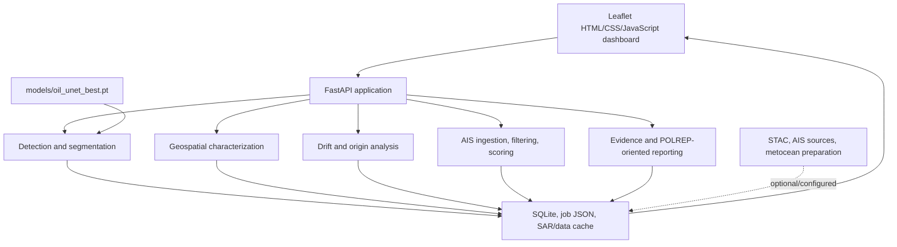

# OCEANUS

**Intelligent Satellite Oil Spill Detection, Drift Analysis, AIS Vessel Attribution & Rapid Response Support**

OCEANUS is the Smart India Hackathon solution for **SIH PS26143**. It connects satellite-based oil-spill detection with geospatial characterization, backward drift analysis, AIS vessel candidate analysis, evidence generation, and POLREP-oriented response support.

The system is decision support. A vessel result is a ranked set of candidates based on available spatial, temporal, trajectory, vessel-type, and behavioural evidence. It is not an automatic legal accusation or proof of responsibility.

## 1. Overview

An oil slick can be detected in a satellite image without revealing when it was released, where it originated, or which vessels were nearby. OCEANUS links those questions into one traceable workflow. A SAR scene is segmented, the detected geometry is measured, a backward ensemble estimates an origin zone, AIS tracks are filtered around that zone and time window, and the resulting candidates are scored with explainable factors.

The application runs as a Python/FastAPI service with a browser dashboard. It supports local files and cached data for offline operation; network-backed preparation and optional live integrations are clearly surfaced when used.

## 2. SIH Problem Statement

**SIH PS26143:** use satellite imagery to determine oil spills at sea and correlate the result with AIS data to identify the vessel associated with the spill.

The implemented workflow addresses detection and characterization, use of meteorological and oceanographic fields for origin and forward drift analysis, and historic AIS reconstruction with spatio-temporal and behavioural scoring.

Intended stakeholders include maritime and pollution-response authorities, coast guards, environmental monitoring teams, analysts, and investigators who need reproducible evidence for follow-up. The output supports investigation and report preparation; it does not replace an official determination.

## 3. Solution

```mermaid
flowchart LR
    A[SAR satellite scene] --> B[Preprocessing]
    B --> C[U-Net++ segmentation]
    C --> D[Spill mask]
    D --> E[Geospatial characterization]
    E --> F[Origin and backward drift analysis]
    F --> G[AIS candidate search]
    G --> H[Multi-factor vessel attribution]
    H --> I[Evidence package]
    I --> J[POLREP-oriented report]
    J --> K[Interactive dashboard]
```



The main orchestration endpoint is `POST /api/run`. A job document records the input, stage trace, detection, drift, attribution, warnings, and configuration used for the run. A scene with no oil polygon does not receive an invented vessel ranking: drift and attribution are skipped.

## 4. Key Features

- SAR GeoTIFF scene ingestion, registered scenes, and georeferenced uploads.
- Optional Sentinel-1 STAC search and fetch through the scene endpoints.
- Three-class segmentation representation: sea, look-alike, and mineral oil.
- Tiled U-Net++ inference with overlapping tile stitching when the checkpoint and training dependencies are available.
- A dB/Sigma0 threshold baseline when the trained detector cannot be loaded.
- Spill masks and GeoJSON polygons with area, perimeter, length, width, orientation, compactness, centroid, bounding box, and contrast features.
- Optional Sentinel-2 optical corroboration; it is corroboration, not a fused second detector, and acquisition-time differences are reported.
- Backward origin estimation and forward drift cone using cached environmental fields and an RK2 ensemble in `app/drift`.
- AIS ingestion into SQLite, time-window and geographic queries, one-minute track reconstruction, gap handling, and track playback data.
- Ranked vessel candidates using proximity, timing, trajectory, vessel type, behaviour, and track-confidence factors, with reason codes and contributions.
- Evidence and provenance in job JSON, GeoJSON export, and a POLREP-oriented HTML attribution note. PDF output is optional when `reportlab` is installed.
- FastAPI endpoints for health, scenes, detection, drift, attribution, AIS, scoring, jobs, reports, and metocean cache inspection.
- Leaflet dashboard served by FastAPI for scene, spill, drift, vessel, method, job, and report views.
- Offline/cached operation is supported. Scene/STAC retrieval and live data preparation are network-dependent and are not required for the offline path.

## 5. AI / Computer Vision

The shipped checkpoint is `models/oil_unet_best.pt`. Its recorded architecture is:

- U-Net++ (`UnetPlusPlus`) from `segmentation-models-pytorch`.
- `timm-efficientnet-b0` encoder.
- Three output classes: sea, look-alike, and mineral oil.
- Three input channels formed from the ordered SAR bands; the co-polarized band is repeated for the ImageNet-style encoder input.
- Tiled 512 by 512 inference with overlap and cosine-tapered stitching.
- Checkpoint normalization metadata is used by inference; the loader falls back to mean `-18.0` dB and standard deviation `6.0` when it is absent.

The checkpoint report records validation results on the repository's held-out validation tiles: oil IoU `0.8891`, sea IoU `0.9822`, mIoU `0.9356`, pixel accuracy `0.9844`, and water-false-oil rate `0.0106`. These are checkpoint evaluation values, not a claim of field accuracy. Look-alike IoU is `NaN` because the available training labels do not provide a supervised look-alike class. Look-alike handling is therefore limited and path-dependent; the baseline can emit look-alike polygons, while the shipped checkpoint's metric does not establish look-alike discrimination.

PyTorch and `segmentation-models-pytorch` are optional for the lightweight runtime, but are installed by the Docker image for CPU inference. CUDA is not required and is not claimed as a deployment target.

## 6. Geospatial & Drift Analysis

Raster processing uses Rasterio when available, with repository fallbacks for supported TIFF cases. PyProj provides local projected geometry where available, and spherical formulas are used as a fallback. The pipeline extracts georeferenced polygons and computes their geographic and metric properties.

The drift implementation reads cached wind/current cubes, interpolates fields in space and time, and runs a 50-particle RK2 ensemble. Backward integration estimates an origin zone and time; forward integration creates a forecast cone, hourly track, threatened bounding box, and optional coast-impact flag. The reported age is a drift-time proxy, not a chemical weathering age.

The repository's current request-time implementation is NumPy-based in `app/drift`; OpenDrift/OpenOil are not imported or required by the application. Cached metocean data is not guaranteed to be bundled for every region. When a matching cache is unavailable, the application reports warnings and the limitations of its fallback rather than presenting synthetic fields as real observations.

## 7. AIS Vessel Attribution

AIS data is stored and queried through SQLite using a MarineCadastre-compatible schema. The pipeline can reconstruct tracks, preserve and analyse gaps, filter traffic by the estimated origin zone and time window, and rank candidates with the following evidence families:

- spatial proximity to the estimated origin;
- temporal proximity to the estimated release time;
- course/trajectory alignment;
- vessel-type prior; and
- behavioural signals such as speed, course changes, and relevant AIS gaps, moderated by track confidence.

Each candidate includes a score, component details, weighted contributions, and reason codes. Scores are absolute weighted results, not a forced winner among the vessels present. The output is an evidence-based investigation queue, not proof that a vessel caused the spill.

AIS can be populated from local or prepared MarineCadastre data. AISStream is an optional configured live-stream integration when its configuration is available; no API key is included in this repository. Synthetic AIS exists for permitted uncovered/demo scenarios and must be treated as simulated data.

## 8. Evidence & POLREP

Run documents and reports can contain:

- scene and detector metadata, timestamps, warnings, and data provenance;
- spill polygons, centroid, area, dimensions, orientation, and confidence;
- origin estimate, origin-zone geometry, drift timing, metocean source/mode, hindcast, forecast, and coast-impact information;
- AIS coverage status, store statistics, reconstructed tracks, candidates, scores, factor details, and reason codes; and
- GeoJSON layers for GIS inspection and an HTML Maritime Pollution Attribution Note, with optional PDF generation.

This is POLREP-oriented response support. It is not an officially certified POLREP submission, legal finding, or court-admissible evidence package by itself. Analysts must review source quality, coverage, uncertainty, and the warnings attached to each run.

## 9. Dashboard

The FastAPI application serves the frontend at `/`. The Leaflet dashboard provides scene selection, SAR/spill overlays, geospatial measurements, drift and forecast layers, vessel tracks, ranked candidates, scoring method details, job progress/history, warnings, and report/GeoJSON access where the relevant job data exists.

## Screenshots

<!-- Add screenshots here -->

## 10. System Architecture



Runtime processing is designed around local files and caches. Preparation scripts may fetch external data, while the offline test boundary keeps network clients out of the application request path. Docker Compose adds the FastAPI container and an Nginx gateway; it does not imply a hosted deployment.

## 11. Technology Stack

| Layer | Technology |
| --- | --- |
| Backend | FastAPI, Uvicorn, Pydantic |
| AI | PyTorch, segmentation-models-pytorch |
| Model | U-Net++, timm EfficientNet-B0 encoder |
| Geospatial | Rasterio, PyProj, NumPy, SciPy where installed, repository geometry/TIFF fallbacks |
| Drift | NumPy RK2 ensemble, cached wind/current fields, repository coast-mask support |
| AIS | Repository AIS implementation, SQLite, MarineCadastre-compatible schema, AISStream when configured |
| Frontend | HTML, CSS, JavaScript, Leaflet |
| Persistence | SQLite for AIS; JSON job documents and filesystem data/cache |
| Reporting | HTML; optional ReportLab PDF |
| Deployment | Docker, Docker Compose, Nginx configuration |
| Testing | Pytest |

## 12. Project Structure

```text
OCEANUS/
├── app/
│   ├── api/                 # FastAPI route modules
│   ├── ais/                 # AIS ingestion, interpolation, filtering, scoring
│   ├── drift/               # Fields, advection, cones, land handling
│   ├── eo/                  # Optional optical corroboration
│   ├── geo/                 # Raster, CRS, geometry, TIFF support
│   ├── jobs/                # Job persistence
│   ├── ml/                  # Dataset, model, inference, training, fallback
│   ├── sar/                 # STAC search/fetch support
│   ├── static/              # Dashboard and vendored Leaflet assets
│   ├── viz/                 # Overlay/tile generation
│   ├── config.py
│   ├── main.py
│   ├── pipeline.py
│   └── schemas.py
├── data/                    # Local scenes, AIS, caches, and job output
├── docs/                    # Architecture, compliance, and presentation material
├── kaggle/                  # Training/data-preparation kernels
├── models/
│   ├── oil_unet_best.pt     # Shipped trained checkpoint
│   └── quarantine/          # Retained experimental checkpoint artefacts
├── nginx/                   # Nginx configuration
├── scripts/                 # Data preparation, demo, training, and sync tools
├── tests/                   # Automated tests
├── Dockerfile
├── docker-compose.yml
├── pyproject.toml
├── requirements.txt
├── LICENSE
├── PROJECT_JOURNAL.md
└── README.md
```

Large SAR, AIS, and metocean inputs are local/runtime assets and are excluded from version control where configured; they should not be assumed to be bundled with a fresh clone. The checkpoint is present in the repository at the path shown above.

## Quick Start

Python 3.11 or newer is required.

```powershell
python -m venv .venv
.venv\Scripts\Activate.ps1
python -m pip install -r requirements.txt
python -m uvicorn app.main:app --host 127.0.0.1 --port 8000
```

Open `http://127.0.0.1:8000`. Use the preparation scripts while online when additional scenes, AIS, or metocean caches are needed. The application can also be run with Docker:

```bash
docker compose up --build
```

The repository's automated tests are run with:

```bash
pytest
```

In this checkout, `pytest -q` reports **115 passed, 6 skipped, and 24 warnings**. Test fixtures and locally prepared data determine which end-to-end scenes are available; no claim is made here about unbundled external datasets.

## Limitations and Responsible Use

- A model validation score is not operational accuracy. The checkpoint metrics above apply to the recorded validation tiles only.
- Look-alike supervision is incomplete, so the trained model's undefined look-alike IoU must be considered when interpreting its output.
- Drift quality depends on the spatial and temporal coverage of cached fields; missing or synthetic fallback data is reported as a limitation.
- AIS attribution depends on reception density, coverage, timestamp quality, reconstructed gaps, and the available search window.
- EO corroboration is optional and may be obscured or acquired at a different time from the SAR observation.
- No result guarantees attribution, legal responsibility, prosecution, or regulatory acceptance. Human review and independent evidence remain required.
